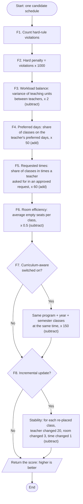
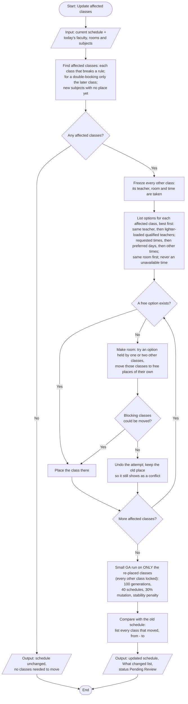

# SchedWiseAI Optimization Engine Flowcharts

These flowcharts describe the scheduling engine **as it is now built** (`engine.js`). They replace the earlier flowchart, which showed a Python engine using Google OR-Tools CP-SAT. That engine is no longer part of the system: the starting schedule is now built with a **greedy constraint-based method** and then improved by a **Genetic Algorithm (GA)**.

There are three charts:

1. [Full schedule generation](#1-full-schedule-generation-runga) — what happens when you press **Generate Schedule** or **Full Regenerate**.
2. [Fitness evaluation](#2-fitness-evaluation-fitness) — how one candidate schedule is scored. It is used inside charts 1 and 3.
3. [Incremental update](#3-incremental-update-repairschedule) — what happens when you press **Update affected classes**.

Each chart has a diagram (GitHub draws it from the Mermaid code) and a step table you can use to redraw it in your paper with standard flowchart symbols: **oval** = start/end, **rectangle** = process, **diamond** = decision, **parallelogram** = input/output.

---

## Terms

| Term | Meaning |
|---|---|
| Gene | One class: `{ teacher, room, time slot }` for one subject section. |
| Schedule (individual, chromosome) | A list of genes, one per subject section. |
| Population | A group of candidate schedules that the GA improves together. |
| Generation | One round of making a new population from the current one. |
| Hard rule | A rule that must not be broken (see chart 2, step F2). |
| Fitness | The score of a schedule. **Higher is better.** |

---

## 1. Full schedule generation (`runGA`)

```mermaid
flowchart TD
    A([Start: Generate Schedule]) --> B[/Input: faculty, rooms, subject sections,<br/>36 time slots Mon-Sat x 6 periods, settings/]
    B --> C["Greedy seed: take the next section; try the time slots,<br/>qualified teachers and suitable rooms in order<br/>(a fixed-time section only tries its fixed slot)"]
    C --> D{Found a slot, teacher and room that are free<br/>and not a time the teacher marked unavailable?}
    D -- Yes --> D2[Place the section there]
    D -- No --> E[Give it a random gene;<br/>the GA will fix it later]
    D2 --> D3{More sections?}
    E --> D3
    D3 -- Yes --> C
    D3 -- No --> F[Initial population:<br/>the seed + 49 random schedules]
    F --> G[Score every schedule<br/>with the fitness function - chart 2]
    G --> H[Elitism: copy the best 10%<br/>into the next generation unchanged]
    H --> I[Tournament selection:<br/>pick 4 at random, keep the best;<br/>do it twice for two parents]
    I --> J[Single-point crossover:<br/>first part of parent 1 + rest of parent 2]
    J --> K["Mutation: each gene may be replaced by a random valid one<br/>(rate starts at 8% and falls to 1.6% by the last generation)"]
    K --> L[Score the child - chart 2]
    L --> M{Next generation full?<br/>50 schedules}
    M -- No --> I
    M -- Yes --> N[Record best and average score<br/>for the convergence chart]
    N --> O{Best score unchanged for 20 generations<br/>AND best score above -1000?}
    O -- Yes --> Q
    O -- No --> P{Reached 140 generations?}
    P -- No --> H
    P -- Yes --> Q[Take the best schedule found in any generation]
    Q --> R[Count rule violations;<br/>conflict-free if the total is 0]
    R --> S[/Output: schedule, fitness score, conflict report,<br/>convergence history; status Pending Review/]
    S --> T([End])
```

| Step | Symbol | What happens |
|---|---|---|
| 1 | Oval | **Start** (Generate Schedule or Full Regenerate). |
| 2 | Parallelogram | **Input**: faculty (specializations, maximum units, preferred days, unavailable times), rooms (capacity), subject sections (specialization needed, online or laboratory, students, optional fixed day/period), 36 time slots, settings. |
| 3 | Rectangle | **Greedy seed**: take the next section and try the time slots, qualified teachers and suitable rooms in order. A fixed-time section only tries its fixed slot. |
| 4 | Diamond | Is there a combination that is free and not a time the teacher marked unavailable? **Yes** → step 5. **No** → step 6. |
| 5 | Rectangle | Place the section in the first such combination. |
| 6 | Rectangle | Give the section a random gene (a qualified teacher and a suitable room at a random time, or its fixed time). The GA fixes it later. |
| 7 | Diamond | More sections? **Yes** → step 3. **No** → step 8. |
| 8 | Rectangle | **Initial population**: the seed plus 49 random schedules (50 in all). |
| 9 | Rectangle | **Evaluate** each schedule with the fitness function (chart 2). |
| 10 | Rectangle | **Elitism**: the best 10% (5 schedules) go into the next generation unchanged, so the best answer is never lost. |
| 11 | Rectangle | **Selection**: tournament of 4, done twice, gives two parents. |
| 12 | Rectangle | **Crossover**: cut both parents at one random point and join them. |
| 13 | Rectangle | **Mutation**: each gene has a small chance of being replaced by a new random valid gene. The chance falls from 8% to 1.6% over the run (explore early, refine late). |
| 14 | Rectangle | **Evaluate** the child (chart 2). |
| 15 | Diamond | Is the next generation full (50)? **No** → step 11. **Yes** → step 16. |
| 16 | Rectangle | Record the generation's best and average score (shown as the convergence chart). |
| 17 | Diamond | **Early stop**: has the best score stayed the same for 20 generations *and* is it above −1000 (which normally means no hard-rule violation)? **Yes** → step 19. **No** → step 18. |
| 18 | Diamond | Reached 140 generations? **No** → next generation (step 10). **Yes** → step 19. |
| 19 | Rectangle | Take the best schedule found in any generation. |
| 20 | Rectangle | Count the rule violations. The schedule is *conflict-free* if the total is 0. |
| 21 | Parallelogram | **Output**: the schedule, its fitness score, the conflict report and the convergence history. Its approval status is *Pending Review*. |
| 22 | Oval | **End**. |

---

## 2. Fitness evaluation (`fitness`)

| Step | Term | Effect on the score |
|---|---|---|
| F1–F2 | **Hard rules.** Each violation of: teacher qualified for the subject; teacher not double-booked; teacher not in an unavailable time; room not double-booked (online classes need no room); laboratory class in a laboratory, online class with no room; enough seats; fixed day/period respected. | −1000 each |
| F3 | **Workload balance**: variance of total teaching units per teacher (0 = perfectly even). | −2 × variance |
| F4 | **Preferred days**: share of classes on the teacher's preferred days (0 to 1). | +50 × share |
| F5 | **Requested times**: share of classes placed in times a teacher asked for in an approved "prefer instead" request. It is 0 when no teacher has such times. | +60 × share |
| F6 | **Room efficiency**: average empty seats per class (online classes count as 0). | −0.5 × average |
| F7 | **Curriculum overlaps** (only when curriculum-aware is on): classes of the same program, year level and semester at the same time. | −150 each |
| F8 | **Stability** (only during an incremental update): for each class being re-placed, a changed teacher, room or time. | −20 / −3 / −1 |

Because −1000 is far larger than every other term, any schedule with a hard-rule violation scores below every conflict-free schedule. The GA therefore removes conflicts first, then improves fairness, preferences and room use.

**Not in the score:** a teacher going over their maximum units (*overload*) is reported on the Workload, Faculty, Departments and Schedules pages, but it is not a hard rule and is not penalised.

---

## 3. Incremental update (`repairSchedule`)

| Step | Symbol | What happens |
|---|---|---|
| U1 | Oval | **Start** (Update affected classes). |
| U2 | Parallelogram | **Input**: the current schedule and today's data (for example after an approved availability change, a new subject or a deleted room). |
| U3 | Rectangle | **Find affected classes**: every class that breaks a hard rule. For a double-booking only the later class is affected, so as few classes as possible move. A newly added subject with no place is also affected. |
| U4 | Diamond | Any affected classes? **No** → output "no classes needed to move" and end. **Yes** → continue. |
| U5 | Rectangle | **Freeze** every other class. |
| U6 | Rectangle | **Rank options** for each affected class: its current teacher first, then qualified teachers with the lightest load; the teacher's requested times first, then their preferred days, then other times; its current room first. Times the teacher is unavailable are never used. |
| U7 | Diamond | Is any option free? **Yes** → place the class (U9). **No** → U8. |
| U8 | Rectangle + diamond | **Make room**: take an option held by one or two other classes and move those classes to free places. If they cannot all be moved, undo everything and leave the class where it was (it still shows as a conflict). |
| U9 | Rectangle | Place the class. Repeat U7 to U9 for every affected class. |
| U10 | Rectangle | **GA polish** on only the re-placed classes (affected classes plus any that were moved to make room). Every other class is locked. 100 generations, 40 schedules, 30% mutation, and the stability penalty (chart 2, F8) so the smallest change wins. |
| U11 | Rectangle | Compare with the old schedule and list every class that moved (from → to). |
| U12 | Parallelogram | **Output**: the updated schedule and the "What changed" list. Approval status *Pending Review*. |
| U13 | Oval | **End**. |

---

## Settings used by the app

| Setting | Full generation | Incremental update |
|---|---|---|
| Population size | 50 | 40 |
| Maximum generations | 140 | 100 |
| Starting mutation rate per gene | 8%, falling to 1.6% | 30%, falling to 6% |
| Elitism | best 10% (5 schedules) | best 10% (4 schedules) |
| Tournament size | 4 | 4 |
| Crossover | single point | single point |
| Early stop | best score unchanged for 20 generations and above −1000 | same |
| Genes that may change | all | only the re-placed classes |
