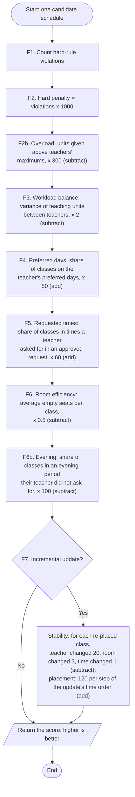
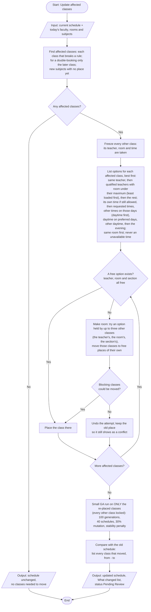

# SchedWiseAI Optimization Engine Flowcharts

These flowcharts describe the scheduling engine **as it is now built** (`engine.js`). They replace the earlier flowchart, which showed a Python engine using Google OR-Tools CP-SAT. That engine is no longer part of the system: the starting schedule is now built with a **greedy constraint-based method** and then improved by a **Genetic Algorithm (GA)**.

There are three charts:

1. [Full schedule generation](#1-full-schedule-generation-runga) — what happens when you press **Generate Schedule** or **Full Regenerate**.
2. [Fitness evaluation](#2-fitness-evaluation-fitness) — how one candidate schedule is scored. It is used inside charts 1 and 3.
3. [Incremental update](#3-incremental-update-repairschedule) — what happens when you press **Update affected classes**.

Each chart has a diagram (GitHub draws it from the Mermaid code) and a step table you can use to redraw it in your paper with standard flowchart symbols: **oval** = start/end, **rectangle** = process, **diamond** = decision, **parallelogram** = input/output.

---

## Terms

| Term | Meaning |
|---|---|
| Gene | One class: `{ teacher, room, time slot }` for one subject section. |
| Schedule (individual, chromosome) | A list of genes, one per subject section. |
| Population | A group of candidate schedules that the GA improves together. |
| Generation | One round of making a new population from the current one. |
| Hard rule | A rule that must not be broken (see chart 2, step F2). |
| Fitness | The score of a schedule. **Higher is better.** |

---

## 1. Full schedule generation (`runGA`)

```mermaid
flowchart TD
    A([Start: Generate Schedule]) --> B[/Input: faculty, rooms, subject sections,<br/>54 time slots Mon-Sat x 9 periods, 7:00 AM-8:30 PM, settings/]
    B --> C["Greedy seed: take the next section; give it to the qualified<br/>teacher with the most room under their maximum units,<br/>at the free time that spreads the week best<br/>(a fixed-time section only tries its fixed slot)"]
    C --> D{Found a time when the teacher, the section<br/>and a suitable room are free, and the teacher<br/>did not mark it unavailable?}
    D -- Yes --> D2[Place the section there]
    D -- No --> E[Give it a random gene;<br/>the GA will fix it later]
    D2 --> D3{More sections?}
    E --> D3
    D3 -- Yes --> C
    D3 -- No --> F[Initial population:<br/>the seed + 49 random schedules]
    F --> G[Score every schedule<br/>with the fitness function - chart 2]
    G --> H[Elitism: copy the best 10%<br/>into the next generation unchanged]
    H --> I[Tournament selection:<br/>pick 4 at random, keep the best;<br/>do it twice for two parents]
    I --> J[Single-point crossover:<br/>first part of parent 1 + rest of parent 2]
    J --> K["Mutation: each gene may be replaced by a random valid one<br/>(rate starts at 8% and falls to 1.6% by the last generation)"]
    K --> L[Score the child - chart 2]
    L --> M{Next generation full?<br/>50 schedules}
    M -- No --> I
    M -- Yes --> N[Record best and average score<br/>for the convergence chart]
    N --> O{Best score unchanged for 20 generations<br/>AND best schedule breaks no hard rule?}
    O -- Yes --> Q
    O -- No --> P{Reached 140 generations?}
    P -- No --> H
    P -- Yes --> Q[Take the best schedule found in any generation]
    Q --> R[Count rule violations;<br/>conflict-free if the total is 0]
    R --> S[/Output: schedule, fitness score, conflict report,<br/>convergence history; status Pending Review/]
    S --> T([End])
```

| Step | Symbol | What happens |
|---|---|---|
| 1 | Oval | **Start** (Generate Schedule or Full Regenerate). |
| 2 | Parallelogram | **Input**: faculty (specializations, maximum units, preferred days, unavailable times), rooms (capacity), subject sections (specialization needed, online or laboratory, students, optional fixed day/period), 54 time slots (nine 1.5-hour periods a day, 7:00 AM to 8:30 PM), settings. |
| 3 | Rectangle | **Greedy seed**: take the next section and give it to the qualified teacher with the most room left under their maximum units (least loaded first; teachers it would take over their maximum come last). A fixed-time section only tries its fixed slot. |
| 4 | Diamond | Is there a time when the teacher is free and available, the section (its students) has no other class, and a suitable room is free? **Yes** → step 5. **No** → step 6. |
| 5 | Rectangle | Of those times, place the section at the one that spreads the week best: a daytime period first (the evening, from 4:00 PM, only when no daytime period is free), then a day the teacher prefers, then the day this section has the fewest classes on, then the day this teacher has the fewest classes on, then the period with the fewest classes so far, then the earliest. |
| 6 | Rectangle | Give the section a random gene (a qualified teacher and a suitable room at a random time, or its fixed time). The GA fixes it later. |
| 7 | Diamond | More sections? **Yes** → step 3. **No** → step 8. |
| 8 | Rectangle | **Initial population**: the seed plus 49 random schedules (50 in all). |
| 9 | Rectangle | **Evaluate** each schedule with the fitness function (chart 2). |
| 10 | Rectangle | **Elitism**: the best 10% (5 schedules) go into the next generation unchanged, so the best answer is never lost. |
| 11 | Rectangle | **Selection**: tournament of 4, done twice, gives two parents. |
| 12 | Rectangle | **Crossover**: cut both parents at one random point and join them. |
| 13 | Rectangle | **Mutation**: each gene has a small chance of being replaced by a new random valid gene. The chance falls from 8% to 1.6% over the run (explore early, refine late). |
| 14 | Rectangle | **Evaluate** the child (chart 2). |
| 15 | Diamond | Is the next generation full (50)? **No** → step 11. **Yes** → step 16. |
| 16 | Rectangle | Record the generation's best and average score (shown as the convergence chart). |
| 17 | Diamond | **Early stop**: has the best score stayed the same for 20 generations *and* does the best schedule break no hard rule? (A subject that cannot be placed at all, see chart 2, does not count: no schedule can fix it.) **Yes** → step 19. **No** → step 18. |
| 18 | Diamond | Reached 140 generations? **No** → next generation (step 10). **Yes** → step 19. |
| 19 | Rectangle | Take the best schedule found in any generation. |
| 20 | Rectangle | Count the rule violations. The schedule is *conflict-free* if the total is 0. |
| 21 | Parallelogram | **Output**: the schedule, its fitness score, the conflict report and the convergence history. Its approval status is *Pending Review*. |
| 22 | Oval | **End**. |

---

## 2. Fitness evaluation (`fitness`)

| Step | Term | Effect on the score |
|---|---|---|
| F1–F2 | **Hard rules.** Each violation of: teacher qualified for the subject; teacher not double-booked; teacher not in an unavailable time; room not double-booked (online classes need no room); section not double-booked (the same program, section name, semester and school year never has two classes at once, online or not); laboratory class in a laboratory, online class with no room; enough seats; fixed day/period respected; and every subject can be placed at all (it has a qualified teacher and, for a laboratory class, a lab big enough). | −1000 each |
| F2b | **Overload**: every unit a teacher is given above their maximum units. | −300 per unit |
| F3 | **Workload balance**: variance of total teaching units per teacher (0 = perfectly even). | −2 × variance |
| F4 | **Preferred days**: share of classes on the teacher's preferred days (0 to 1). | +50 × share |
| F5 | **Requested times**: share of classes placed in times a teacher asked for in an approved "prefer instead" request. It is 0 when no teacher has such times. | +60 × share |
| F6 | **Room efficiency**: average empty seats per class (online classes count as 0). | −0.5 × average |
| F6b | **Evening**: share of classes in an evening period (4:00 to 8:30 PM) that their teacher did not ask for in an approved *Prefer instead* request. It is more than a preferred day is worth, so a daytime period beats an evening one on a preferred day. | −100 × share |
| F7 | **Stability and placement** (only during an incremental update): for each class being re-placed, a changed teacher, room or time costs 20 / 3 / 1. A class that keeps its teacher also scores for where it lands, in the order chart 3 uses (step U6): its own time 6, a time the teacher asked for 5, another daytime period on that day 4, an evening period on that day 3, a daytime period on a preferred day 2, any other daytime period 1, any other evening period 0, times 120. This keeps the GA polish from undoing that order. | −20 / −3 / −1; +120 per step |

Because −1000 is far larger than every other term, any schedule with a hard-rule violation scores below every conflict-free schedule. The GA therefore removes conflicts first, then improves fairness, preferences and room use.

**Overload** (a teacher going over their maximum units) is not a hard rule, so it never stops a schedule from being called conflict-free; it is reported on the Workload, Faculty, Departments and Schedules pages. But each unit over costs 300, more than all the preference terms together, so the GA only leaves a teacher over their maximum when the subject's other teachers have no room left.

---

## 3. Incremental update (`repairSchedule`)

| Step | Symbol | What happens |
|---|---|---|
| U1 | Oval | **Start** (Update affected classes). |
| U2 | Parallelogram | **Input**: the current schedule and today's data (for example after an approved availability change, a new subject or a deleted room). |
| U3 | Rectangle | **Find affected classes**: every class that breaks a hard rule. For a double-booking (of a teacher, a room or a section) only the later class is affected, so as few classes as possible move. A newly added subject with no place is also affected. |
| U4 | Diamond | Any affected classes? **No** → output "no classes needed to move" and end. **Yes** → continue. |
| U5 | Rectangle | **Freeze** every other class. |
| U6 | Rectangle | **Rank options** for each affected class: its current teacher first, then qualified teachers who still have room under their maximum units (least loaded first), and last those it would take over their maximum. Times in this order: the class's own time if it is still allowed (for example when only its room was removed), the times the teacher asked for in an approved *Prefer instead* request (even in the evening), other times on those days (daytime first), daytime periods on the teacher's preferred days, other daytime periods, then the evening, 4:00 to 8:30 PM (ties in week order). Its current room first. Times the teacher is unavailable are never used. |
| U7 | Diamond | Is any option free (the teacher, the room and the class's section have nothing else at that time)? **Yes** → place the class (U9). **No** → U8. |
| U8 | Rectangle + diamond | **Make room**: take an option held by up to three other classes (the one holding the teacher, the room or the section's students) and move those classes to free places. If they cannot all be moved, undo everything and leave the class where it was (it still shows as a conflict). |
| U9 | Rectangle | Place the class. Repeat U7 to U9 for every affected class. |
| U10 | Rectangle | **GA polish** on only the re-placed classes (affected classes plus any that were moved to make room). Every other class is locked. 100 generations, 40 schedules, 30% mutation, and the stability penalty (chart 2, F7) so the smallest change wins. |
| U11 | Rectangle | Compare with the old schedule and list every class that moved (from → to). |
| U12 | Parallelogram | **Output**: the updated schedule and the "What changed" list. Approval status *Pending Review*. |
| U13 | Oval | **End**. |

---

## Settings used by the app

| Setting | Full generation | Incremental update |
|---|---|---|
| Population size | 50 | 40 |
| Maximum generations | 140 | 100 |
| Starting mutation rate per gene | 8%, falling to 1.6% | 30%, falling to 6% |
| Elitism | best 10% (5 schedules) | best 10% (4 schedules) |
| Tournament size | 4 | 4 |
| Crossover | single point | single point |
| Early stop | best score unchanged for 20 generations and no hard-rule violation (except subjects that cannot be placed at all) | same |
| Genes that may change | all | only the re-placed classes |
